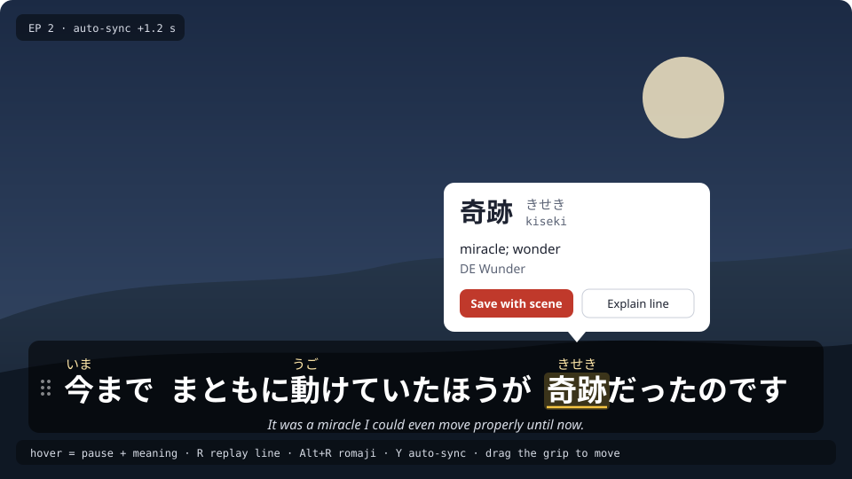
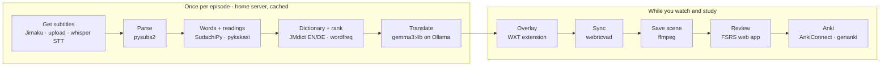

<div align="center">


# Japanese Ultimate Sensei

**Learn Japanese from the anime you already watch.**

Furigana subtitles on any streaming site · one-click word mining with the exact scene ·
spaced repetition that syncs with Anki · all running on your own hardware.


</div>

<p align="center">
  
  <br><sub>Illustration of the overlay on a streaming site: furigana over the kanji, a highlighted word worth learning, and the hover popup.</sub>
</p>

## What it does

| | |
|---|---|
| **Furigana subtitles on any site** | A browser extension puts the Japanese line over the player, with readings over the kanji and a romaji toggle (Alt+R). Drag it anywhere; the position is saved per site. |
| **Subtitles find themselves** | Japanese subtitles come from Jimaku automatically. Attach one episode of a series, and the next one attaches itself. Upload your own `.srt`/`.ass`, or transcribe episodes that have none (speech-to-text). |
| **Only the words worth learning** | Each word is linked to JMdict (English + German) and ranked by frequency, so only the most useful unknown words get highlighted. Known words lose their furigana. |
| **Hover to understand** | Hovering a word pauses the video and shows the reading and meaning. "Explain this line" asks a local LLM for a translation, a word-by-word breakdown and the grammar. |
| **Save the scene, not just the word** | One click saves the word with a screenshot, the audio of the line and a short clip, compressed to about 0.3 MB per card. |
| **Review that sticks** | FSRS spaced repetition in the web app, with the scene on every card. Push cards to Anki, export `.apkg`, or import your Anki deck as known words. |
| **Subtitles in sync** | ±100 ms hotkeys, or Auto-sync: the extension records a short audio sample and the server matches speech to subtitle timing. |
| **See your progress** | A GitHub-style activity heatmap and a "% of this episode I understand" meter. |
| **Private by design** | Everything runs on your own machines over Tailscale. No cloud AI, no accounts. |

## How it works

<picture>
  <source media="(prefers-color-scheme: dark)" srcset="docs/assets/architecture-dark.svg">
  
</picture>

The **home server** does the work and stores everything. It has no GPU, so heavy steps run once
per episode as cached background jobs. The **GPU laptop** only runs the AI models. The
**extension** overlays, captures and talks to the server; the **web app** works from any device.

### From episode to review card



## Models and tech

| Step | Runs on | Tech |
|---|---|---|
| Subtitles | home server | [Jimaku](https://jimaku.cc) API, pysubs2; auto-import remembers the series |
| Speech-to-text | GPU laptop | [whisper.cpp](https://github.com/ggml-org/whisper.cpp) `whisper-server`, large-v3-turbo q5_0 (kotoba-whisper v2 optional); ffmpeg extracts 16 kHz audio |
| Words + readings | home server | SudachiPy (split mode B, sudachidict-core), readings in hiragana, pykakasi for romaji |
| Dictionary + ranking | home server | JMdict via jmdict-simplified (EN + DE, offline SQLite), wordfreq Zipf scores |
| Translation + explanations | GPU laptop | **gemma3:4b** on Ollama, OpenAI-compatible API in JSON mode, 12 lines per batch with context and character names |
| Overlay + capture | laptop, Edge/Firefox | WXT (Manifest V3), TypeScript, captureStream + MediaRecorder |
| Auto-sync | home server | webrtcvad + loudness, cross-correlation over ±2 min with a confidence check |
| Media | home server | ffmpeg: WebP 640 px, Opus 32 kbps, VP9 360p clips |
| Review | home server + web app | py-fsrs 6, genanki, React 18, Vite 6, Tailwind 4, TanStack Query |
| Storage + API | home server | FastAPI, SQLite + SQLModel, Alembic migrations, systemd service |
| Network | everything | Tailscale only, plus a bearer token on every API call |

### Choosing the translation model

Benchmarked with `python -m app.llm_bench` on 36 lines of a real episode (English + German), on a
laptop GPU with about 4 GB of VRAM:

| Model | per line | est. episode | Notes |
|---|---:|---:|---|
| qwen2.5:3b | 10.7 s | 57 min | fits the GPU, but mixed German into the English column |
| **gemma3:4b** | **7.8 s** | **42 min** | best translations; chosen |
| qwen2.5:7b | 13.6 s | 73 min | slower, no better |

With the prompt fixes from #104 (character names kept as names, readings copied from the
tokenizer), gemma3:4b in production runs at about **2.5 s per line, ≈ 13 min per episode**, in the
background.

## Status

The v0.1 core loop is live on the home server: subtitles, overlay, mining, review, Anki,
translations, auto-sync and in-place extension updates. Speech-to-text is built on the server and
in the web app; it's waiting for whisper-server on the GPU laptop. See the
[task board](docs/TASKS.md).

## Repository layout

| Path | What | Owner |
|---|---|---|
| `server/` | FastAPI backend on the home server (Python 3.12, uv) | Claude |
| `extension/` | Browser extension, WXT, Edge/Chromium + Firefox | Antigravity |
| `web/` | Web app (React + Vite + TS): library, player, review, words, stats | Antigravity |
| `docs/` | Vision, architecture, decisions, API contract, task board | everyone |

Two AI agents build this project for one human owner. They coordinate through GitHub issues, pull
requests with reviews, and [AGENTS.md](AGENTS.md).

## Quick start (server)
```bash
curl -LsSf https://astral.sh/uv/install.sh | sh      # once, if uv is missing
cd server
uv sync                                               # installs Python 3.12 + deps
uv run python -m app.dictionary_setup                 # downloads JMdict EN+DE → data/jmdict.sqlite
uv run pytest                                         # tests
cp .env.example .env                                  # then set SENSEI_API_TOKEN (≥ 16 chars, required)
# or skip this: deploy/install-service.sh generates the token for you
uv run uvicorn app.main:create_app --factory --host 0.0.0.0 --port 8000
```

### Run it for real (background service)
```bash
(cd web && pnpm install && pnpm build)                # web app → served by the server at /
bash deploy/install-service.sh                        # starts now + on boot, restarts on crash
bash deploy/update.sh                                 # later: pull, rebuild, restart
journalctl --user -u sensei -f                        # logs
uv run python -m app.backup                           # manual DB backup → data/backups/ (nightly is automatic)
```
Open `http://<server-tailscale-name>:8000/` for the web app; the extension uses the same URL.
Interactive API docs: `http://<server>:8000/docs`.

### Optional: AI on a GPU machine
Set these in `server/.env` and restart. Any OpenAI-compatible server works.
```bash
SENSEI_LLM_BASE_URL=http://<gpu-host>:11434/v1        # Ollama
SENSEI_LLM_MODEL=gemma3:4b
SENSEI_STT_BASE_URL=http://<gpu-host>:8080/v1         # whisper.cpp whisper-server
```

### Install the extension
Download `http://<server>:8000/downloads/sensei-extension-chrome.zip` (or `-firefox.zip`), extract
it to a folder, and load it unpacked (`edge://extensions` → Developer mode → Load unpacked). Enter
the server URL and token in Options. For later updates, the popup shows "Update available" with a
one-line command, then Reload.

## Docs
- [Vision & decisions](docs/VISION.md): what we're building and why
- [Architecture](docs/ARCHITECTURE.md): components, data flow, data model
- [API contract](docs/API.md) + [`openapi.json`](docs/openapi.json)
- [Decision log](docs/DECISIONS.md)
- [Task board](docs/TASKS.md) and [agent conventions](AGENTS.md)

## Attribution
- [JMdict](https://www.edrdg.org/jmdict/j_jmdict.html) © Electronic Dictionary Research and
  Development Group, used under [CC BY-SA 4.0](https://www.edrdg.org/edrdg/licence.html), via
  [jmdict-simplified](https://github.com/scriptin/jmdict-simplified).
- [SudachiPy / SudachiDict](https://github.com/WorksApplications/sudachi.rs) (Apache-2.0).
- [wordfreq](https://github.com/rspeer/wordfreq) word frequencies (data CC BY-SA 4.0).
- Subtitles from [Jimaku](https://jimaku.cc). Translation model: Gemma 3 (Gemma Terms of Use) via
  [Ollama](https://ollama.com).
