<a name="top"></a>

<p align="center">
  <picture>
    <source media="(prefers-color-scheme: dark)" srcset="docs/assets/readme/banner-night.webp">
    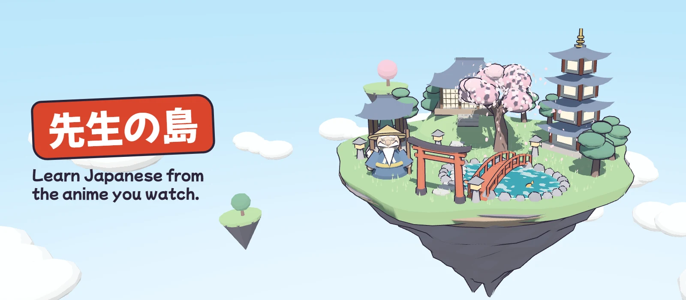
  </picture>
</p>

<h1 align="center">Japanese Ultimate Sensei</h1>

<p align="center">
  <b>Watch. Catch the word. Keep the scene.</b><br>
  Furigana subtitles on any streaming site, a dictionary on hover, and review cards that remember<br>
  exactly where you heard a word. All of it runs on your own hardware.
</p>

<p align="center">
  <a href="server/"></a>
  <a href="extension/"></a>
  <a href="web/"></a>
  <a href="site/"></a>
  
</p>

<p align="center">
  <a href="#the-idea">The idea</a> ·
  <a href="#sensei-island-the-app">The app</a> ·
  <a href="#what-it-can-do">Features</a> ·
  <a href="#get-started">Get started</a> ·
  <a href="#the-website">Website</a> ·
  <a href="#how-it-works">How it works</a> ·
  <a href="#development">Development</a>
</p>

<p align="center">
  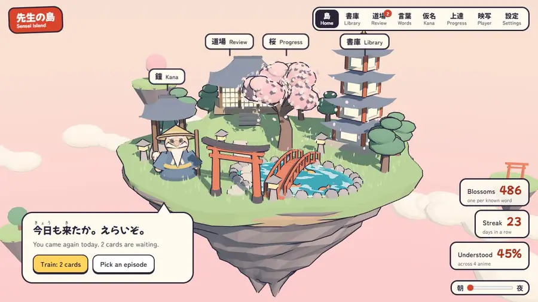
  <br><sub>The app's home page, from morning to night. Screenshots in this README use example data.</sub>
</p>

<br>

## The idea

Watching anime with English subtitles is fun and teaches almost nothing. Flashcards teach, but they
have nothing to do with the stories you care about. Sensei joins the two:

<table>
  <tr>
    <td width="25%" valign="top"><h3>観 Watch</h3>Open your usual streaming site. Japanese subtitles find themselves, with readings above the kanji.</td>
    <td width="25%" valign="top"><h3>拾 Catch</h3>Hover a word and the video waits. Only the few most useful unknown words in a line are marked.</td>
    <td width="25%" valign="top"><h3>残 Keep</h3>One click saves the word with its screenshot, the voice saying the line, and a short clip.</td>
    <td width="25%" valign="top"><h3>磨 Review</h3>Short daily sessions show you the scene first. Words you know lose their furigana.</td>
  </tr>
</table>

<p align="center">
  
  <br><sub>Illustration of the overlay on a streaming site.</sub>
</p>

Then a number climbs: **how much of this episode you understand**. That is the whole point. One day
you turn the subtitles off.

<br>

## Sensei Island, the app

The web app is a small living world. Your progress is something you can see grow.

| On the island | What it means |
|---|---|
| 🌸 **The cherry tree** | One blossom for every word you know |
| 🏯 **The pagoda** | One floor per anime, best understood at the bottom (up to five) |
| 🔔 **The bell** | Rings when you read kana correctly |
| 🍃 **Falling petals** | Burst when a review goes well; the sensei jumps too |
| 🌗 **The sky** | Follows your clock from dawn to night, or the slider |

<p align="center">
  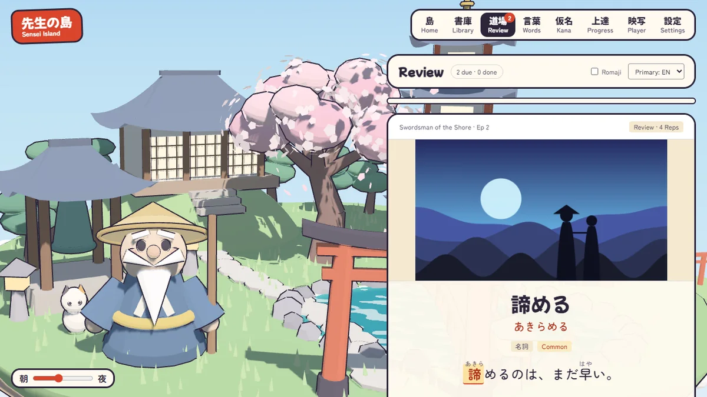
  <br><sub>A review: first the scene, then the word.</sub>
</p>

<table>
  <tr>
    <td width="50%">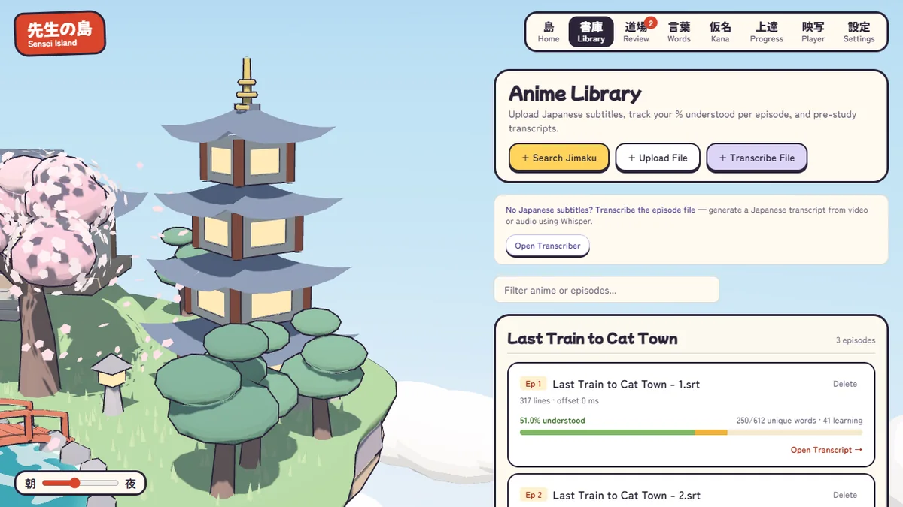<br><b>書庫 Library</b>: your anime and how much of each episode you understand</td>
    <td width="50%">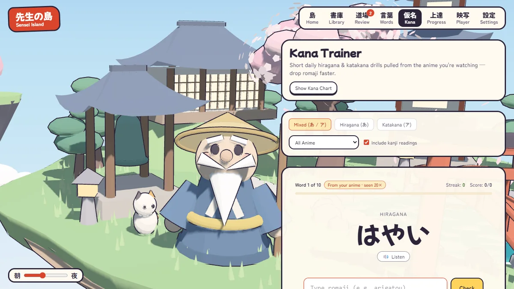<br><b>仮名 Kana</b>: short drills with words from your own shows</td>
  </tr>
  <tr>
    <td>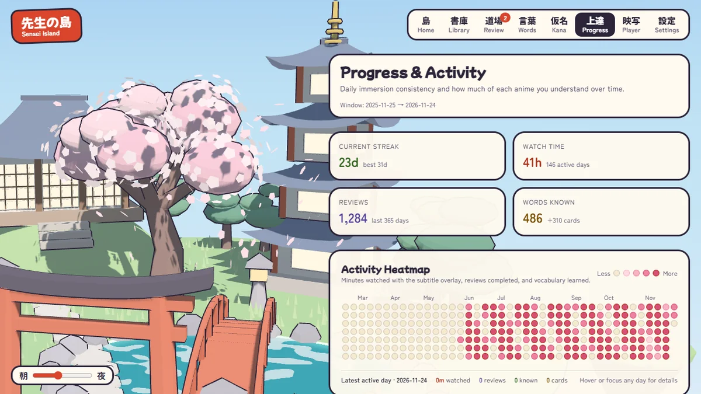<br><b>上達 Progress</b>: streak, heatmap and understanding over time</td>
    <td>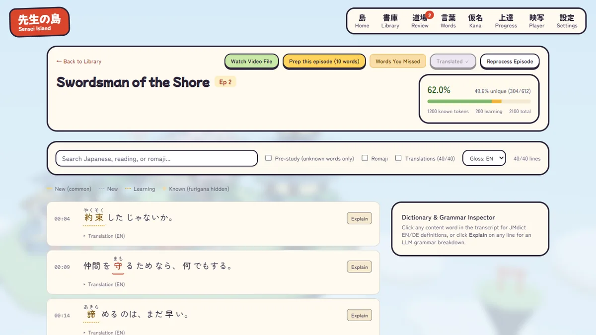<br><b>Episode</b>: the full transcript, translations and grammar notes</td>
  </tr>
  <tr>
    <td>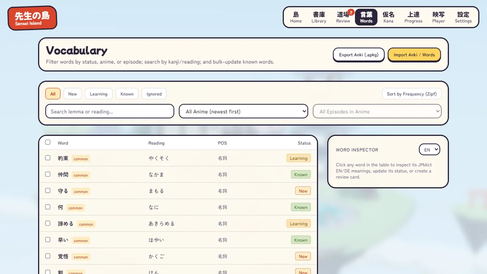<br><b>言葉 Words</b>: everything you have met, filter and mark in bulk</td>
    <td>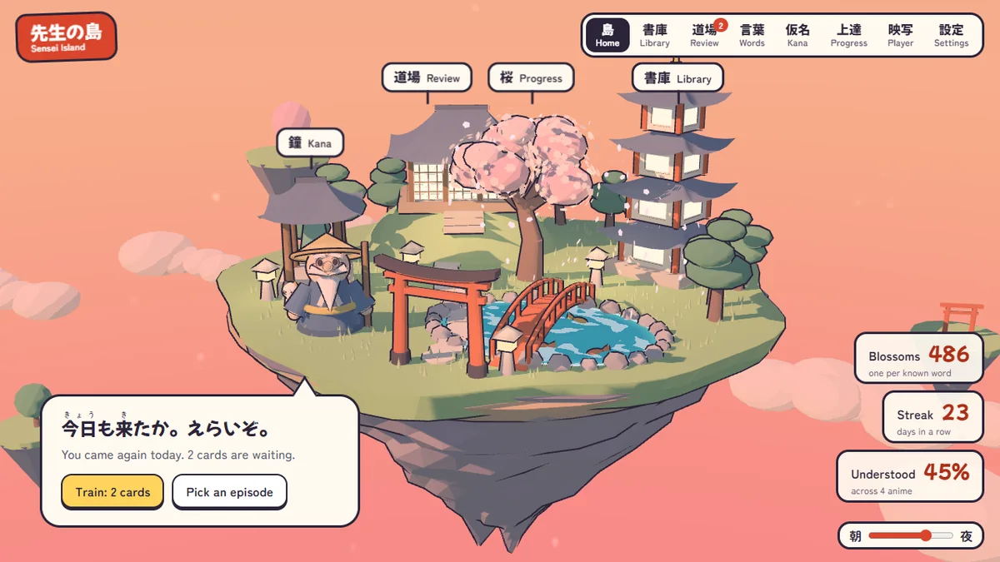<br><b>島 Home</b>: what is due, and how the island has grown</td>
  </tr>
</table>

<p align="center">
  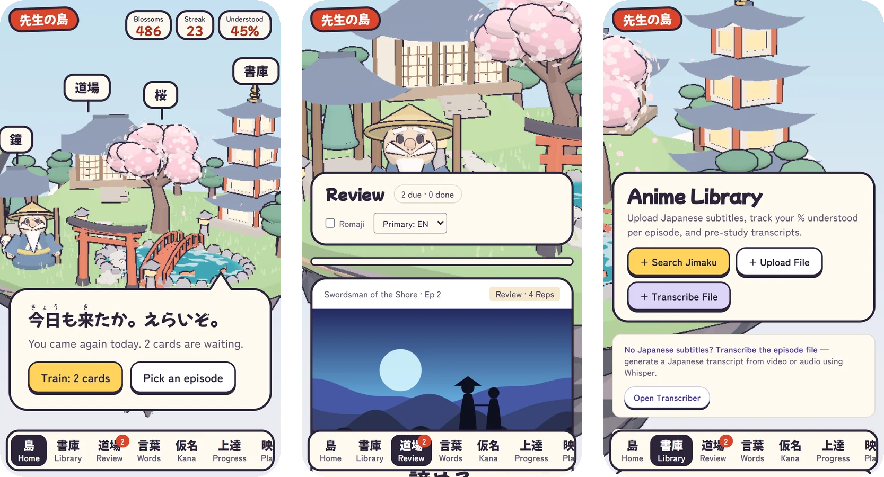
  <br><sub>Add it to your phone's home screen for reviews on the train.</sub>
</p>

The 3D never gets in the way. It loads after the page works, slows down behind dense pages, and
stops completely while you watch a video. Settings has Full, Light and Off; phones start on Light.

<br>

## What it can do

| | |
|---|---|
| **Furigana on any site** | The extension lays the Japanese line over the player, with readings over the kanji and a romaji toggle (<kbd>Alt</kbd>+<kbd>R</kbd>). Drag it anywhere; the position is saved per site. |
| **Subtitles find themselves** | Japanese subtitles come from [Jimaku](https://jimaku.cc). Attach one episode and the next attaches itself. Or upload `.srt` / `.ass`, or transcribe an episode that has none. |
| **Only the words worth learning** | Every word is linked to JMdict (English and German) and ranked by frequency. Known words lose their furigana. |
| **Explain this line** | A local language model translates the line and explains it word by word. |
| **Save the scene, not just the word** | Screenshot, line audio and a short clip, about 0.3 MB per card. |
| **Review that sticks** | FSRS spaced repetition with the scene on every card, also on your phone. |
| **Friends with Anki** | Push cards with AnkiConnect, export `.apkg`, or import your deck as known words. |
| **Subtitles in sync** | ±100 ms hotkeys, or Auto-sync: a short audio sample is matched to the subtitle timing, and sync points survive cuts. |
| **Before and after an episode** | Prepare its ten most useful words, then collect the good ones you missed. |
| **Your own files** | A built-in player gives downloaded episodes the same overlay. |
| **Private by design** | Your own machines over Tailscale, one token. No cloud AI, no accounts. |

<br>

## Get started

You need a Linux machine that stays on (the **server**) and the **browser extension** on the computer
you watch on. Ours is an i5-7200U laptop processor from 2016 with 7 GB of RAM and no graphics card.

### 1 · Server

```bash
# once: uv, ffmpeg, Node 22 + pnpm
curl -LsSf https://astral.sh/uv/install.sh | sh

cd server
uv sync                                   # Python 3.12 and dependencies
uv run python -m app.dictionary_setup     # downloads JMdict EN + DE
cd ..

(cd web && pnpm install --frozen-lockfile && pnpm build)
bash deploy/install-service.sh            # generates the token, starts now and on boot
bash deploy/update.sh                     # builds the extension, so step 2 can download it
```

Open `http://<server>:8000/`, go to **Settings**, and paste the token that the installer put into
`server/.env`.

> [!TIP]
> Put a free [Jimaku](https://jimaku.cc) key into `SENSEI_JIMAKU_API_KEY` in `server/.env`, and
> subtitles are found for you.

### 2 · Extension

On Windows, in PowerShell (no admin rights needed):

```powershell
iwr http://<server>:8000/downloads/install-updater.ps1 -OutFile $env:TEMP\i.ps1
powershell -ExecutionPolicy Bypass -File $env:TEMP\i.ps1 -Server http://<server>:8000
```

Then load the folder it shows once in `edge://extensions` (Developer mode → **Load unpacked**) and
enter the server address and token in **Options**. From then on, **Update now** in the popup is
enough. The zips for Edge, Chrome and Firefox are also in the [releases](../../releases).

### 3 · Watch something

Open an episode, click the Sensei icon, pick the subtitles. The next episode attaches itself.

<details>
<summary><b>Optional: translations and speech-to-text on a GPU machine</b></summary>

<br>

Any OpenAI-compatible server works. Set these in `server/.env` and restart:

```bash
SENSEI_LLM_BASE_URL=http://<gpu-host>:11434/v1        # Ollama
SENSEI_LLM_MODEL=gemma3:4b
SENSEI_STT_BASE_URL=http://<gpu-host>:8080/v1         # whisper.cpp whisper-server
```
</details>

<details>
<summary><b>Optional: better auto-sync</b></summary>

<br>

Auto-sync can recognize Japanese speech on the server's CPU instead of only detecting voices. The
model is about 160 MB; without it, Sensei uses voice activity.

```bash
cd server && uv run python -m app.asr_setup
```
</details>

<details>
<summary><b>Everyday commands</b></summary>

<br>

| What | Command |
|---|---|
| Update everything | `bash deploy/update.sh` |
| Logs | `journalctl --user -u sensei -f` |
| Backup now (nightly is automatic) | `cd server && uv run python -m app.backup` |
| Where is my token? | `grep SENSEI_API_TOKEN server/.env` |
| Interactive API docs | `http://<server>:8000/docs` |
</details>

<br>

## The website

A landing page that explains the idea, in **English and Japanese**. Ink particles
write one kanji per section in front of drifting mountains, and you can try a subtitle and a review
card right on the page.

<p align="center">
  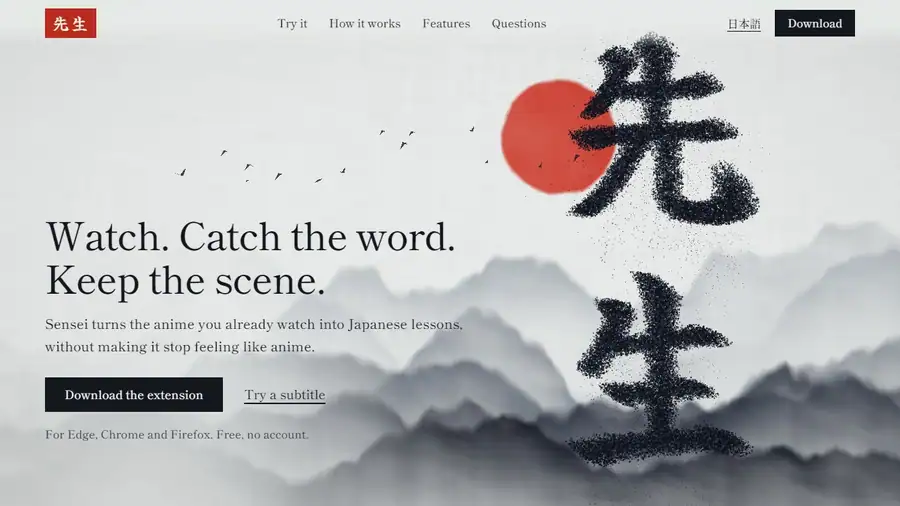
</p>

<table>
  <tr>
    <td width="50%"></td>
    <td width="50%">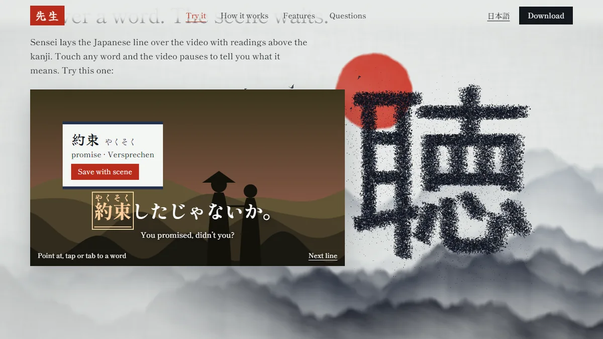</td>
  </tr>
</table>

> [!NOTE]
> **Ready, but not published.** The site is built and tested in this private repository, and no
> workflow publishes it on its own.

Look at it on your machine:

```bash
cd site
pnpm install --frozen-lockfile
node build.mjs
npx serve dist        # English at /, Japanese at /ja/
```

<details>
<summary><b>What is prepared, and how to publish it later</b></summary>

<br>

- Downloads of the latest extension with version, size and SHA-256, bundled at build time
- A guard that stops the build if a download contains a private hostname, address, path or token
- Share images, sitemap, robots, 404, credits; no cookies, no analytics, fonts hosted with the site
- [`pages.yml`](.github/workflows/pages.yml): builds and tests pull requests, publishes only by hand

Before the first publish:

1. Settings → Pages → Source: **GitHub Actions** (the repository is public, so Pages is available).
2. Actions → **Website** → Run workflow → tick **publish**.

Details: [`site/README.md`](site/README.md)
</details>

<br>

## How it works

<picture>
  <source media="(prefers-color-scheme: dark)" srcset="docs/assets/architecture-dark.svg">
  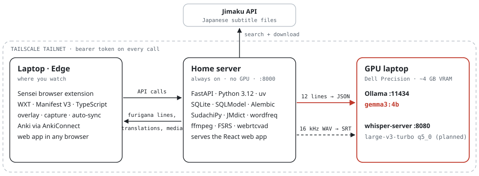
</picture>

The **home server** does the work and stores everything; heavy steps run once per episode as cached
background jobs. The **GPU laptop** only runs the AI models. The **extension** overlays, captures and
talks to the server. The **app** works from any device.

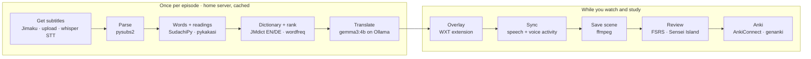

<details>
<summary><b>Models and tech, step by step</b></summary>

<br>

| Step | Runs on | Tech |
|---|---|---|
| Subtitles | home server | [Jimaku](https://jimaku.cc) API, pysubs2; auto-import remembers the series |
| Speech-to-text | GPU laptop | [whisper.cpp](https://github.com/ggml-org/whisper.cpp) `whisper-server`, large-v3-turbo q5_0 (kotoba-whisper v2 optional); ffmpeg extracts 16 kHz audio |
| Words + readings | home server | SudachiPy (split mode B, sudachidict-core), readings in hiragana, pykakasi for romaji |
| Dictionary + ranking | home server | JMdict via jmdict-simplified (EN + DE, offline SQLite), wordfreq Zipf scores |
| Translation + explanations | GPU laptop | **gemma3:4b** on Ollama, OpenAI-compatible API in JSON mode, 8 lines per batch with context and character names |
| Overlay + capture | laptop, Edge/Firefox | WXT (Manifest V3), TypeScript, captureStream + MediaRecorder |
| Auto-sync | home server | ReazonSpeech k2 via sherpa-onnx when installed, else webrtcvad + loudness; cross-correlation with a confidence check |
| Media | home server | ffmpeg: WebP 640 px, Opus 32 kbps, VP9 360p clips |
| Review | home server + app | py-fsrs 6, genanki, React 18, Vite 6, Tailwind 4, TanStack Query |
| The island and the ink | browser | three.js, built from primitives and shaders: no 3D models or textures to download |
| Storage + API | home server | FastAPI, SQLite + SQLModel, Alembic migrations, systemd service |
| Network | everything | Tailscale only, plus a bearer token on every API call |
</details>

<details>
<summary><b>Choosing the translation model</b></summary>

<br>

Benchmarked with `python -m app.llm_bench` on 36 lines of a real episode (English + German), on a
laptop GPU with about 4 GB of VRAM:

| Model | per line | est. episode | Notes |
|---|---:|---:|---|
| qwen2.5:3b | 10.7 s | 57 min | fits the GPU, but mixed German into the English column |
| **gemma3:4b** | **7.8 s** | **42 min** | best translations; chosen |
| qwen2.5:7b | 13.6 s | 73 min | slower, no better |

With the prompt fixes from #104 (character names kept as names, readings copied from the
tokenizer), gemma3:4b in production runs at about **2.5 s per line, ≈ 13 min per episode**, in the
background.
</details>

<br>

## Development

| Path | What | Run | Check |
|---|---|---|---|
| [`server/`](server/) | FastAPI backend, Python 3.12, uv | `uv run uvicorn app.main:create_app --factory --reload` | `uv run pytest` · `uv run ruff check .` |
| [`extension/`](extension/) | Browser extension, WXT + TypeScript | `pnpm dev` | `pnpm test` · `pnpm lint` |
| [`web/`](web/) | Sensei Island, React + Vite + three.js | `pnpm dev` | `pnpm test` · `pnpm lint` · `pnpm build` |
| [`site/`](site/) | The website, static, EN + JA | `node build.mjs` | `pnpm test` |
| [`docs/`](docs/) | Vision, architecture, decisions, API contract, task board | | |
| [`deploy/`](deploy/) · [`scripts/`](scripts/) | Service install, update, releases, extension updater | | |

The API contract lives in [`server/app/schemas.py`](server/app/schemas.py);
[`docs/openapi.json`](docs/openapi.json) and the frontends' types are generated from it.

<details>
<summary><b>Who builds this</b></summary>

<br>

Two AI agents, Claude Code and Antigravity, build this project with its human owners. Claude leads
(server, architecture, docs); Antigravity owns the extension and the web app, and Claude built Sensei
Island and the website on request. They coordinate through GitHub issues, pull requests and
[AGENTS.md](AGENTS.md).
</details>

### Status

| | |
|---|---|
| ✅ **Live** | Subtitles, overlay, saving scenes, review, Anki, translations, auto-sync, in-place extension updates |
| 🌱 **New** | Sensei Island (the app's new look) and the website |
| 🔧 **In progress** | Speech-based auto-sync on real episodes (#147), speech-to-text with a real whisper-server (#131) |

What comes next is on the [task board](docs/TASKS.md).

### Docs

[Vision](docs/VISION.md) · [Architecture](docs/ARCHITECTURE.md) · [API contract](docs/API.md) ·
[Decisions](docs/DECISIONS.md) · [Task board](docs/TASKS.md) · [Agent conventions](AGENTS.md)

<br>

## Credits

- [JMdict](https://www.edrdg.org/jmdict/j_jmdict.html) © Electronic Dictionary Research and
  Development Group, used under [CC BY-SA 4.0](https://www.edrdg.org/edrdg/licence.html), via
  [jmdict-simplified](https://github.com/scriptin/jmdict-simplified)
- [SudachiPy / SudachiDict](https://github.com/WorksApplications/sudachi.rs) (Apache-2.0)
- [wordfreq](https://github.com/rspeer/wordfreq) word frequencies (data CC BY-SA 4.0)
- Subtitles from [Jimaku](https://jimaku.cc); translation model Gemma 3 (Gemma Terms of Use) via
  [Ollama](https://ollama.com)
- [three.js](https://threejs.org) (MIT); fonts Mochiy Pop One, Zen Maru Gothic, Yuji Boku and
  Shippori Mincho (SIL OFL 1.1)

Sensei contains no anime and is not affiliated with any streaming service or studio.

## License

[MIT](LICENSE) © 2026 Mohamed Yacine Dhouafli and contributors. Third-party data, models and fonts keep their own
licenses (see Credits); the dictionary data is downloaded at setup and is not part of this repository.

The helper scripts in `scripts/` default to the author's home server (`barkhausstr64`, a name that only resolves
inside the author's private network). Pass your own server with `-Server` (PowerShell) or as the argument of
`release_notes.py`.

<p align="center"><br><b lang="ja">物語の一言が、いつか君の言葉になる。</b><br><sub>A line from a story will one day be your own word.</sub><br><br><a href="#top">Back to top</a></p>
